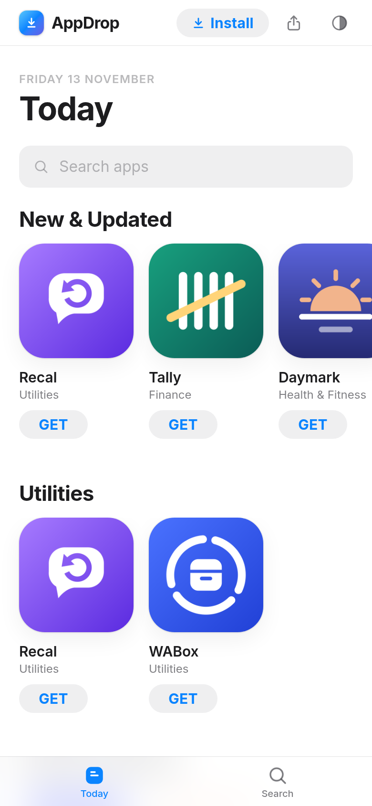
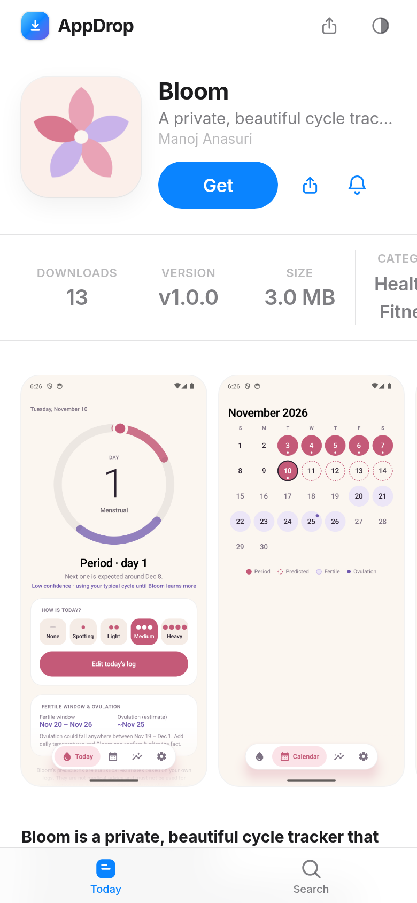
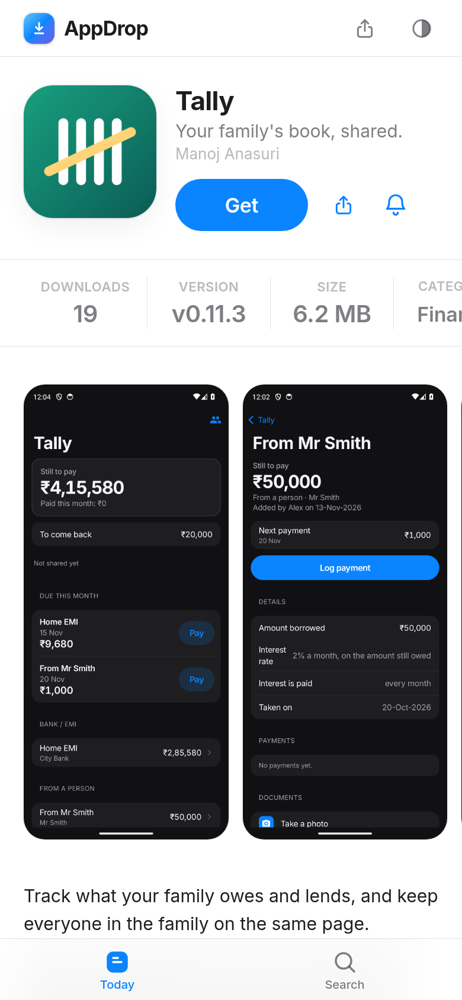

<div align="center">


# AppDrop

**Your own app store. Ship Android and web apps to friends and family, straight from GitHub Releases.**

[](https://appdrop-store.vercel.app)


<br>

<table>
  <tr>
    <td align="center"><picture>
      <source media="(prefers-color-scheme: dark)" srcset="docs/screenshots/home-dark.png">
      
    </picture></td>
    <td align="center"><picture>
      <source media="(prefers-color-scheme: dark)" srcset="docs/screenshots/app-dark.png">
      
    </picture></td>
    <td align="center"><picture>
      <source media="(prefers-color-scheme: dark)" srcset="docs/screenshots/detail-dark.png">
      
    </picture></td>
  </tr>
</table>

<sub>The store adapts to light and dark mode. Try it live at <a href="https://appdrop-store.vercel.app">appdrop-store.vercel.app</a>.</sub>

</div>

---

Publish the Android apps and web apps you build in one place, and let people install them straight from the source. Apps are backed by GitHub Releases, so shipping a new version is just cutting a release. Fork it and run your own, see [Deployment](#deployment).

## Features

- **Android apps**: download the `.apk` straight from the release, with version, size and checksum info.
- **Web apps**: open them in the browser or install them as PWAs.
- **Installable store**: the store itself is a PWA with an offline page and an install prompt.
- **Auto-sync from GitHub**: release lists refresh in the background (stale-while-revalidate), with an optional webhook for instant updates.
- **Simple admin**: a password-protected panel to add apps, edit the listing and screenshots, and set visibility.
- **Quiet by default**: drafts are hidden, nothing is indexed by search engines, and the GitHub token never leaves the server.
- **In-app update checks (Android)**: installed apps can tell when a newer release is out (see [In-app updates](#in-app-updates)).
- **Push notifications**: "Notify me" per app, plus store-wide alerts, when a new release is published.
- **Feedback**: a store feedback form and an in-app feedback form, stored per app.
- **Beta channel**: invite links for testers, who then get pre-release builds.
- **Insights**: views by source, downloads by version, active devices and the share of devices on the latest version.
- **Backups**: a protected export endpoint plus a script to download the whole database.

## Architecture

- **Next.js 16** full-stack App Router (React 19, Server Actions, route handlers), output `standalone`.
- **SQLite / libSQL** through **Drizzle ORM**. A local `file:` database by default, or a Turso `libsql://` database. The schema migrates on boot.
- **GitHub REST API** for releases and assets, called only from the server with a fine-grained token.
- **Downloads** go through `/d/<slug>/<assetId>`, which resolves the asset from the app's own database and redirects to a short-lived signed GitHub URL.
- **Sync**: stale-while-revalidate with a `SYNC_TTL_MINUTES` window. An optional GitHub release webhook at `/api/webhooks/github` triggers an immediate resync.
- **PWA**: web app manifest, runtime-generated icons, and a hand-written service worker (`public/sw.js`).

## Local development

Requirements: Node.js 22+.

```bash
npm i
cp .env.example .env.local     # then fill in ADMIN_PASSWORD and SESSION_SECRET
npm run totp:setup             # scan the QR in your authenticator app, add ADMIN_TOTP_SECRET to .env.local
npm run dev
```

Open <http://localhost:3000>, then sign in at <http://localhost:3000/admin>.

Generate a session secret with `openssl rand -hex 32`.

## Creating a GitHub token

1. Go to **GitHub → Settings → Developer settings → Fine-grained personal access tokens → Generate new token**.
2. Name it (for example `appdrop`) and set an expiry.
3. Under **Repository access**, choose **Only select repositories** and pick the repos that contain your apps.
4. Under **Permissions**, set **Contents: Read-only** and **Metadata: Read-only**. Leave everything else off.
5. Generate the token and put it in `GITHUB_TOKEN` in `.env.local` (or your host's secrets).

The token is needed for private repos and raises the API rate limit. Public repos work without it.

## Adding apps

In `/admin`, add an app and point it at a GitHub repo (`owner/name`) or at a web app URL.

- **Android app**: pick the repo, then the sync pulls its releases and `.apk` assets. If a release has several APKs, set an **asset pattern** (for example `*-release.apk`). Otherwise an asset with `universal` in its name is preferred.
- **Web app**: give the app's URL. Visitors open it in the browser or install it from the store.

Visibility controls where an app shows: **public** lists it in the store, **unlisted** is reachable only by direct link, and **draft** is visible to the admin only.

## Release conventions

- Attach the built `.apk` files to a **GitHub Release**. Tag the release with the version (for example `v1.2.0`).
- If you publish several APKs in one release, name the one you want people to get with `universal` or match it with the asset pattern.
- Optional: add `fastlane/metadata/android/` to the repo (title, short and full descriptions, changelogs, screenshots). The admin can import it in one click to fill in the store listing.

## Webhook (optional, instant updates)

1. Set `GITHUB_WEBHOOK_SECRET` to a long random string, in `.env.local` or on your host.
2. In the repo, go to **Settings → Webhooks → Add webhook**:
   - **Payload URL**: `https://YOUR_HOST/api/webhooks/github`
   - **Content type**: `application/json`
   - **Secret**: the same value as `GITHUB_WEBHOOK_SECRET`
   - **Which events**: select **Let me select individual events**, then tick **Releases**.
3. Save. New releases now appear in the store right away instead of at the next TTL.

## Push notifications

Visitors can tap **Notify me** on an app to hear about its new releases, or subscribe to store-wide alerts.

1. Generate a VAPID key pair: `npx web-push generate-vapid-keys`
2. In Vercel (or your host), set `VAPID_PUBLIC_KEY`, `VAPID_PRIVATE_KEY` and `VAPID_SUBJECT` (for example `mailto:you@example.com`).
3. Redeploy. Without both keys, push is disabled.

Android Chrome works straight from the browser. On iOS, notifications only work after the store is installed to the Home Screen (iOS 16.4+).

## Beta channel

Testers get pre-release builds through a private invite link.

1. In `/admin/beta`, create an invite link for each tester (the link is shown once, so copy it then).
2. Publish beta builds as GitHub **pre-releases** (`node scripts/appdrop.mjs release --prerelease`, or tick "pre-release" on GitHub). Pre-releases are shown to browsers with an active invite, and to apps that have "include pre-releases" turned on.
3. The tester opens the link once on their device. Revoke an invite at any time in `/admin/beta`, which stops that link from giving access.

## In-app updates

Android apps can check the store for a newer release and prompt the user to update. The client side is in [`docs/android-updates.md`](docs/android-updates.md). To add the check to an Android project, run `node scripts/appdrop.mjs add-updater` in that project's folder.

## Backups

A protected endpoint, `/api/backup`, exports the whole database as one `backup-<timestamp>.ndjson.gz` file. Backups contain everything, including push subscriptions and feedback, so keep them private and out of git (`backups/` is already in `.gitignore`).

There is deliberately no GitHub Actions workflow for this: on a public repository, workflow artifacts can be downloaded by any signed-in GitHub user. Run the script from your own machine (or a cron job on a private host) instead.

**Setup**

1. Generate a token: `openssl rand -hex 32`.
2. Add it to your host as `BACKUP_TOKEN`, and redeploy. Without it the endpoint returns 404.

**Run a backup**: `APPDROP_URL=https://apps.example.com BACKUP_TOKEN=... node scripts/backup.mjs --out backups`

**Restore into a new database**

1. Create the new database (for example a fresh Turso database) and start AppDrop once against it so it creates its tables: set `DATABASE_URL` and `DATABASE_AUTH_TOKEN` to the new database, run `npm run dev`, and open the site.
2. From the repo root, restore the file:
   ```bash
   node scripts/restore-backup.mjs backups/backup-2026-11-10T03-30.ndjson.gz \
     --db libsql://your-new-db.turso.io --auth-token <token>
   ```
   The script asks for confirmation (or pass `--yes`). It refuses to write into a database that already has apps unless you pass `--force`.
3. Point `DATABASE_URL` at the restored database and redeploy.

The restore script has no default database, so it can't touch your live database by accident.

## Environment variables

| Variable | Required | Notes |
| --- | --- | --- |
| `ADMIN_PASSWORD` | Yes | Admin passphrase |
| `ADMIN_TOTP_SECRET` | Yes | Authenticator secret, from `npm run totp:setup` |
| `SESSION_SECRET` | Yes | At least 32 characters. `openssl rand -hex 32` |
| `GITHUB_TOKEN` | Recommended | Fine-grained PAT, Contents and Metadata read-only |
| `GITHUB_WEBHOOK_SECRET` | No | Enables `/api/webhooks/github` |
| `DATABASE_URL` | No | Default `file:./data/appdrop.db`. Use `libsql://…` for Turso |
| `DATABASE_AUTH_TOKEN` | With Turso | Token for the `libsql://` database |
| `SYNC_TTL_MINUTES` | No | Minutes before a release list is refreshed. Default 15 |
| `APPDROP_API_KEY` | No | Publishing API key (at least 32 characters). Empty disables the API |
| `NEXT_PUBLIC_SITE_NAME` | No | Store name. Default `AppDrop` |
| `NEXT_PUBLIC_SITE_URL` | Recommended | Public store URL, used for invite links and metadata. Default `http://localhost:3000` |
| `NEXT_PUBLIC_OWNER_NAME` | No | Owner name on the store. Defaults to the value in `src/lib/brand.ts` |
| `VAPID_PUBLIC_KEY` | For push | From `npx web-push generate-vapid-keys` |
| `VAPID_PRIVATE_KEY` | For push | Keep secret |
| `VAPID_SUBJECT` | For push | `mailto:` or `https:` contact. Default `mailto:admin@example.com` |
| `BACKUP_TOKEN` | For backups | `openssl rand -hex 32`. Used by `scripts/backup.mjs` |

Copy `.env.example` for a full list with comments.

## Deployment

### Option 1: Docker on a VPS, Fly.io or Railway (recommended)

SQLite needs a persistent disk, so this is the simplest setup. The image declares `/app/data` as a volume.

```bash
docker build -t appdrop .
docker run -d --name appdrop -p 3000:3000 \
  -v appdrop-data:/app/data \
  -e ADMIN_PASSWORD='...' \
  -e ADMIN_TOTP_SECRET='...' \
  -e SESSION_SECRET="$(openssl rand -hex 32)" \
  -e GITHUB_TOKEN='...' \
  appdrop
```

- **Fly.io**: create a volume (`fly volumes create appdrop_data --size 1`) and mount it at `/app/data`. Set the secrets with `fly secrets set`.
- **Railway**: add a volume mounted at `/app/data`, and set the variables in the service settings.
- Put a TLS-terminating proxy (Caddy, Traefik, or the platform's own) in front. HSTS is already set by the app.

### Option 2: Vercel + Turso

Use a hosted libSQL database so no disk is needed:

```bash
DATABASE_URL=libsql://your-db-your-org.turso.io
DATABASE_AUTH_TOKEN=...
```

Set the same `ADMIN_PASSWORD`, `ADMIN_TOTP_SECRET`, `SESSION_SECRET` and `GITHUB_TOKEN` in the Vercel project settings.

## Security model

This repository is public and contains no secrets: all configuration comes from environment variables (see `.env.example`). Authentication does not rely on the code being secret.

- **Two-factor admin login**: every sign-in needs the password **and** a 6-digit TOTP code (RFC 6238). Each code works only once (replay-protected), failures share one generic error, and attempts are rate-limited.


- **Token isolation**: the GitHub token is read on the server only and is never sent to the browser.
- **No IDOR on downloads**: asset IDs are resolved only through the app's own database rows. A client cannot ask for an arbitrary GitHub asset.
- **Admin auth**: a password check, then an HS256 JWT in an `httpOnly`, `SameSite=Lax` cookie. Login is rate-limited. Every server action re-checks auth, and `/admin` is also gated in `src/proxy.ts`.
- **Uploads**: validated by magic bytes. SVG is rejected. Media is served with `X-Content-Type-Options: nosniff` and a sandbox CSP.
- **Headers**: a strict Content-Security-Policy, `X-Frame-Options: DENY`, `frame-ancestors 'none'`, `Referrer-Policy`, `Permissions-Policy` and HSTS are set on every response.
- **Downloads**: signed GitHub URLs are short-lived and resolved per request, never stored.
- **Visibility**: draft apps are admin-only, and unlisted apps are never listed in the store.
- **Indexing**: `robots` metadata is `noindex, nofollow`, and admin responses carry `X-Robots-Tag`.

## Publishing from Claude Code

AppDrop has a small publishing API (`/api/v1`) plus a CLI and a Claude Code skill, so you can say "add this app to AppDrop" in any project and have Claude publish it (metadata, icon, screenshots, GitHub release with the APK, sync).

### Setup

1. On the server, set `APPDROP_API_KEY` (at least 32 characters): `openssl rand -hex 32`. Without it the API is disabled (404).
2. On your dev machine (Node 18+; `gh` for releases; Chrome for web screenshots):
   ```bash
   git clone https://github.com/manojanasuri16/AppDrop ~/AppDrop   # if not already there
   node ~/AppDrop/scripts/appdrop.mjs login --url https://your-appdrop.example --key <APPDROP_API_KEY>
   ```
   The key is stored in `~/.config/appdrop/config.json` (mode 0600). `APPDROP_URL` / `APPDROP_API_KEY` env vars override it.
3. Install the skill globally:
   ```bash
   mkdir -p ~/.claude/skills && ln -s ~/AppDrop/skills/appdrop-publish ~/.claude/skills/appdrop-publish
   ```
4. In any app project, tell Claude Code: **"add this app to AppDrop"**.

For private repos, the server's `GITHUB_TOKEN` must include each app repo (see "Creating a GitHub token"). The API can create/update apps and trigger syncs, but cannot delete apps; that stays in `/admin`.

### CLI reference

Run `node scripts/appdrop.mjs <command> --help` for details.

| Command | What it does |
| --- | --- |
| `login --url <url> --key <key>` | Verify and save credentials |
| `init [--kind android\|web] [--force]` | Detect the project in the current folder and write `appdrop.json` |
| `publish [-m file] [--dry-run] [--skip-icon] [--skip-screenshots] [--json]` | Validate, upload metadata/icon/screenshots, sync |
| `release --tag vX.Y.Z --apk app.apk [--notes t \| --notes-file f \| --generate-notes] [--title t] [--prerelease]` | Create/update a GitHub release via `gh`, then sync |
| `status [slug] [--json]` / `list [--json]` | Inspect apps on the server |
| `screenshot-web <url> [--paths "/,/about"] [--out dir] [--width 390 --height 844 --scale 2] [--dark]` | Headless Chrome screenshots |
| `screenshot-android [--out dir] [--name 01-home]` | Screenshot from a connected device via `adb` |

### appdrop.json

Paths are relative to the manifest. See `appdrop.example.json`.

| Field | Notes |
| --- | --- |
| `slug` | Required. Lowercase-dashes, max 60, immutable |
| `kind` | `android` or `web` (inferred if omitted) |
| `name` | Required when creating |
| `tagline` | Max 120 chars |
| `description` / `descriptionFile` | Markdown, max 20000 chars; the file wins |
| `category`, `developer`, `accentColor` (`#rrggbb`), `packageName` | Store listing details |
| `repo` | `owner/repo` or GitHub URL (required for Android) |
| `webUrl` | https URL (required for web) |
| `assetPattern` | Substring or glob to pick the APK when a release has several |
| `includePrereleases`, `featured`, `sortOrder` | Booleans / integer |
| `visibility` | `public`, `unlisted` or `draft` (server default `draft`) |
| `icon` | Path to a PNG/JPEG/WebP/GIF, max 4 MB (no SVG) |
| `screenshots` | Ordered image paths, max 12, replaced on every `publish` |

## Scripts

| Command | What it does |
| --- | --- |
| `npm run dev` | Dev server |
| `npm run build` / `npm start` | Production build and server |
| `npm run lint` | Type check (`tsc --noEmit`) |
| `npm run db:generate` | Generate a Drizzle migration after editing `src/db/schema.ts` |

## Deploying to Netlify

Netlify builds Next.js 16 automatically, with no config file needed. Serverless functions have no persistent disk, so use a hosted database:

1. Create a free [Turso](https://turso.tech) database, then set `DATABASE_URL=libsql://…` and `DATABASE_AUTH_TOKEN`. Tables are created automatically on first request.
2. In Site settings → Environment variables, set `ADMIN_PASSWORD`, `ADMIN_TOTP_SECRET`, `SESSION_SECRET`, `GITHUB_TOKEN` (and optionally `GITHUB_WEBHOOK_SECRET`).
3. Connect the GitHub repo. Build command `npm run build`, no publish directory override.

Notes: Netlify functions accept request bodies up to ~6 MB, so upload screenshots a few at a time. APK downloads are redirects to GitHub, so file size doesn't matter.
